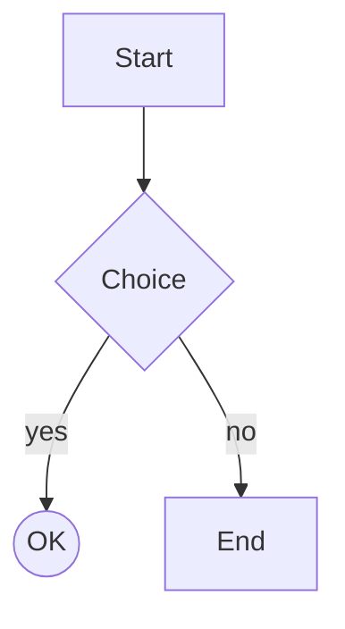

# Mermaid Flowchart Renderer Implementation Plan

> **For agentic workers:** REQUIRED SUB-SKILL: Use superpowers:subagent-driven-development (recommended) or superpowers:executing-plans to implement this plan task-by-task. Steps use checkbox (`- [ ]`) syntax for tracking.

**Goal:** Render `mermaid` fenced code blocks in madesu's preview as ASCII/Unicode flowchart diagrams, falling back silently to plain code blocks for anything unsupported.

**Architecture:** Two new files: `mermaid.go` (hand-written parser producing a `flowGraph`) and `mermaid_layout.go` (simplified layered layout: break cycles → rank by longest path → barycenter ordering → grid placement with orthogonal edge routing). `mdrender.go` hooks mermaid fences to the new renderer; failures fall back to the existing code-block path.

**Tech Stack:** Go 1.26, goldmark (already a dependency), lipgloss for display-width and style. No new dependencies.

**Spec:** `docs/superpowers/specs/2026-11-06-mermaid-flowchart-design.md`

## Global Constraints

- Single Go package `main`; no new dependencies in `go.mod`.
- `go vet ./...` and `go test -race -count=1 ./...` must pass after every task.
- Any parse or layout failure must fall back silently to today's code-block rendering (no warnings, no layout shift).
- Node labels: single line, truncated with `…` beyond 24 display columns (measured with `lipgloss.Width`, never rune count).
- Box glyphs: rect `[l]`, rounded/stadium `(l)`, circle `((l))` (one row); diamond three rows (`╱╲` / `╱ label ╲` / `╲╱`).
- Edge glyphs: normal `│`/`─`, dotted `┆`/`┄`, thick `║`/`═`; arrowheads `▼ ▲ ▶ ◀`; corners `└ ┐ ┘ ┌`.
- Directions: `tb`/`td` and `lr` fully drawn; `bt`/`rl` reuse the same layout with arrowheads flipped.
- Self-loops (`A --> A`), `subgraph`, `classDef`, `class`, `style`, `linkStyle`, `click`, and `%%{...}%%` directives return `errUnsupported`.
- Tests may live in package `main` and call unexported functions directly (matches existing test style).

---

### Task 1: Flowchart types and header parsing

**Files:**
- Create: `mermaid.go`
- Test: `mermaid_test.go`

**Interfaces:**
- Consumes: nothing.
- Produces: `errUnsupported error`; types `shapeKind` (`shapeRect`, `shapeRounded`, `shapeStadium`, `shapeDiamond`, `shapeCircle`), `edgeStyle` (`edgeNormal`, `edgeDotted`, `edgeThick`), `dirKind` (`dirTB`, `dirLR`, `dirBT`, `dirRL`), `flowNode{id, label string; shape shapeKind}`, `flowEdge{from, to, label string; style edgeStyle; arrow bool}`, `flowGraph{dir dirKind; nodes []*flowNode; edges []flowEdge}`; `parseFlowchart(src []byte) (*flowGraph, error)`.

- [ ] **Step 1: Write the failing test**

```go
package main

import (
	"errors"
	"testing"
)

func mustParse(t *testing.T, src string) *flowGraph {
	t.Helper()
	g, err := parseFlowchart([]byte(src))
	if err != nil {
		t.Fatalf("parse %q: %v", src, err)
	}
	return g
}

func TestParseHeader(t *testing.T) {
	cases := []struct {
		src  string
		want dirKind
	}{
		{"flowchart TD", dirTB},
		{"flowchart tb", dirTB},
		{"graph LR", dirLR},
		{"flowchart BT", dirBT},
		{"graph rl", dirRL},
	}
	for _, tc := range cases {
		g := mustParse(t, tc.src)
		if g.dir != tc.want {
			t.Fatalf("%q: dir %v, want %v", tc.src, g.dir, tc.want)
		}
	}
}

func TestParseHeaderRejects(t *testing.T) {
	for _, src := range []string{
		"",
		"\n\n",
		"sequenceDiagram\nA->>B: hi",
		"flowchart\nA --> B",
		"flowchart XX\nA --> B",
		"graph",
	} {
		if _, err := parseFlowchart([]byte(src)); !errors.Is(err, errUnsupported) {
			t.Fatalf("%q: err %v, want errUnsupported", src, err)
		}
	}
}
```

- [ ] **Step 2: Run test to verify it fails**

Run: `go test -run 'TestParseHeader' .`
Expected: FAIL — `undefined: parseFlowchart` (and undefined types).

- [ ] **Step 3: Write minimal implementation**

Create `mermaid.go`:

```go
package main

// Parser for the mermaid flowchart subset (see
// docs/superpowers/specs/2026-11-06-mermaid-flowchart-design.md). Anything
// outside the subset returns errUnsupported so the preview falls back to a
// plain code block.

import (
	"errors"
	"strings"
)

var errUnsupported = errors.New("mermaid: unsupported syntax")

type shapeKind int

const (
	shapeRect shapeKind = iota
	shapeRounded
	shapeStadium
	shapeDiamond
	shapeCircle
)

type edgeStyle int

const (
	edgeNormal edgeStyle = iota
	edgeDotted
	edgeThick
)

type dirKind int

const (
	dirTB dirKind = iota
	dirLR
	dirBT
	dirRL
)

type flowNode struct {
	id    string
	label string
	shape shapeKind
}

type flowEdge struct {
	from, to string
	label    string
	style    edgeStyle
	arrow    bool
}

type flowGraph struct {
	dir   dirKind
	nodes []*flowNode // first-seen order
	edges []flowEdge
}

func parseFlowchart(src []byte) (*flowGraph, error) {
	lines := strings.Split(string(src), "\n")
	head := -1
	for i, l := range lines {
		t := strings.TrimSpace(l)
		if t == "" || strings.HasPrefix(t, "%%") {
			continue
		}
		head = i
		break
	}
	if head < 0 {
		return nil, errUnsupported
	}
	f := strings.Fields(lines[head])
	if len(f) != 2 {
		return nil, errUnsupported
	}
	switch strings.ToLower(f[0]) {
	case "flowchart", "graph":
	default:
		return nil, errUnsupported
	}
	var dir dirKind
	switch strings.ToLower(f[1]) {
	case "td", "tb":
		dir = dirTB
	case "lr":
		dir = dirLR
	case "bt":
		dir = dirBT
	case "rl":
		dir = dirRL
	default:
		return nil, errUnsupported
	}
	p := &parser{g: &flowGraph{dir: dir}, byID: map[string]*flowNode{}}
	for _, l := range lines[head+1:] {
		for _, stmt := range strings.Split(l, ";") {
			stmt = strings.TrimSpace(stripComment(stmt))
			if stmt == "" {
				continue
			}
			if err := p.statement(stmt); err != nil {
				return nil, err
			}
		}
	}
	return p.g, nil
}

type parser struct {
	g    *flowGraph
	byID map[string]*flowNode
}

// statement parses one `;`/newline-separated statement. Body statements are
// added by later tasks; until then everything is unsupported.
func (p *parser) statement(s string) error {
	return errUnsupported
}

// stripComment cuts a `%%` comment that starts outside double quotes.
func stripComment(s string) string {
	inQ := false
	for i := 0; i+1 < len(s); i++ {
		switch s[i] {
		case '"':
			inQ = !inQ
		case '%':
			if !inQ && s[i+1] == '%' {
				return s[:i]
			}
		}
	}
	return s
}
```

- [ ] **Step 4: Run test to verify it passes**

Run: `go test -run 'TestParseHeader' .`
Expected: PASS.

- [ ] **Step 5: Commit**

```bash
go vet ./... && go test -race -count=1 . || true
git add mermaid.go mermaid_test.go
git commit -m "Add mermaid flowchart types and header parsing"
```

---

### Task 2: Node definitions and shapes

**Files:**
- Modify: `mermaid.go`
- Test: `mermaid_test.go`

**Interfaces:**
- Consumes: types from Task 1.
- Produces: `parser.statement(s string) error` now parses node chains; unexported scanner type `scan{s string; pos int}` with `nodeDef(p *parser) (*flowNode, error)`, `shape() (shapeKind, string, bool, error)`, `scanTo(close string) (string, bool)`, `done() bool`, `spaces()`, `peek() byte`; helpers `isIDChar(c byte) bool`, `unquote(s string) string`.

- [ ] **Step 1: Write the failing test**

Append to `mermaid_test.go`:

```go
func TestParseNodeShapes(t *testing.T) {
	g := mustParse(t, "flowchart TD\nA[Box]\nB(Round)\nC([Stad])\nD{Diamond}\nE((Dot))\nF")
	want := []struct {
		id, label string
		shape     shapeKind
	}{
		{"A", "Box", shapeRect},
		{"B", "Round", shapeRounded},
		{"C", "Stad", shapeStadium},
		{"D", "Diamond", shapeDiamond},
		{"E", "Dot", shapeCircle},
		{"F", "F", shapeRect}, // bare id: label defaults to id
	}
	if len(g.nodes) != len(want) {
		t.Fatalf("nodes %d, want %d", len(g.nodes), len(want))
	}
	for i, w := range want {
		n := g.nodes[i]
		if n.id != w.id || n.label != w.label || n.shape != w.shape {
			t.Fatalf("node %d = %+v, want %+v", i, n, w)
		}
	}
	if len(g.edges) != 0 {
		t.Fatalf("edges %d, want 0", len(g.edges))
	}
}

func TestParseQuotedLabel(t *testing.T) {
	g := mustParse(t, `flowchart TD
A["Label with ) parens"]`)
	if g.nodes[0].label != "Label with ) parens" {
		t.Fatalf("label %q", g.nodes[0].label)
	}
}

func TestParseNodeReferenceKeepsDefinition(t *testing.T) {
	// First definition wins; a later bare reference keeps label and shape.
	g := mustParse(t, "flowchart TD\nA[Box]\nA")
	if g.nodes[0].label != "Box" || g.nodes[0].shape != shapeRect {
		t.Fatalf("node = %+v", g.nodes[0])
	}
	if len(g.nodes) != 1 {
		t.Fatalf("duplicate node created: %d", len(g.nodes))
	}
}

func TestParseCommentsAndSemis(t *testing.T) {
	g := mustParse(t, "flowchart TD\n%% a comment\nA[Box]; B(Round) %% trailing\n%% another")
	if len(g.nodes) != 2 {
		t.Fatalf("nodes %d, want 2", len(g.nodes))
	}
}
```

- [ ] **Step 2: Run test to verify it fails**

Run: `go test -run 'TestParse' .`
Expected: FAIL — every body statement returns `errUnsupported`.

- [ ] **Step 3: Implement node parsing**

In `mermaid.go`, replace `statement` and add the scanner:

```go
func (p *parser) statement(s string) error {
	sc := &scan{s: s}
	_, err := sc.nodeDef(p)
	return err
}

type scan struct {
	s   string
	pos int
}

func (sc *scan) done() bool { return sc.pos >= len(sc.s) }

func (sc *scan) peek() byte {
	if sc.pos < len(sc.s) {
		return sc.s[sc.pos]
	}
	return 0
}

func (sc *scan) spaces() {
	for sc.pos < len(sc.s) && (sc.s[sc.pos] == ' ' || sc.s[sc.pos] == '\t') {
		sc.pos++
	}
}

func (sc *scan) nodeDef(p *parser) (*flowNode, error) {
	start := sc.pos
	for sc.pos < len(sc.s) && isIDChar(sc.s[sc.pos]) {
		sc.pos++
	}
	if sc.pos == start {
		return nil, errUnsupported
	}
	id := sc.s[start:sc.pos]
	shape, label, ok, err := sc.shape()
	if err != nil {
		return nil, err
	}
	n := p.byID[id]
	if n == nil {
		n = &flowNode{id: id}
		p.byID[id] = n
		p.g.nodes = append(p.g.nodes, n)
	}
	if ok {
		n.shape, n.label = shape, label
	}
	if n.label == "" {
		n.label = id
	}
	return n, nil
}

func isIDChar(c byte) bool {
	switch {
	case c >= 'a' && c <= 'z', c >= 'A' && c <= 'Z', c >= '0' && c <= '9':
		return true
	case c == '_' || c >= 0x80: // multibyte ids stay inside one node name
		return true
	}
	return false
}

var shapeDelims = []struct {
	open, close string
	kind        shapeKind
}{
	{"([", "])", shapeStadium},
	{"((", "))", shapeCircle},
	{"[", "]", shapeRect},
	{"(", ")", shapeRounded},
	{"{", "}", shapeDiamond},
}

func (sc *scan) shape() (shapeKind, string, bool, error) {
	for _, d := range shapeDelims {
		if !strings.HasPrefix(sc.s[sc.pos:], d.open) {
			continue
		}
		sc.pos += len(d.open)
		label, ok := sc.scanTo(d.close)
		if !ok {
			return 0, "", false, errUnsupported
		}
		return d.kind, label, true, nil
	}
	return 0, "", false, nil
}

// scanTo consumes up to a closing delimiter outside double quotes.
func (sc *scan) scanTo(close string) (string, bool) {
	rest := sc.s[sc.pos:]
	inQ := false
	for i := 0; i+len(close) <= len(rest); i++ {
		switch {
		case rest[i] == '"':
			inQ = !inQ
		case !inQ && strings.HasPrefix(rest[i:], close):
			sc.pos += i + len(close)
			return unquote(strings.TrimSpace(rest[:i])), true
		}
	}
	return "", false
}

func unquote(s string) string {
	if len(s) >= 2 && s[0] == '"' && s[len(s)-1] == '"' {
		return s[1 : len(s)-1]
	}
	return s
}
```

- [ ] **Step 4: Run test to verify it passes**

Run: `go test -run 'TestParse' .`
Expected: PASS.

- [ ] **Step 5: Commit**

```bash
git add mermaid.go mermaid_test.go
git commit -m "Parse mermaid node definitions and shapes"
```

---

### Task 3: Edge operators, labels, chaining

**Files:**
- Modify: `mermaid.go`
- Test: `mermaid_test.go`

**Interfaces:**
- Consumes: `scan`, `flowEdge` from earlier tasks.
- Produces: `(*scan).edge() (flowEdge, error)`, `(*scan).edgeText(arrowTerm, openTerm string) (label string, arrow, ok bool)`, `indexUnquoted(s, sub string) int`.

- [ ] **Step 1: Write the failing test**

Append to `mermaid_test.go`:

```go
func TestParseEdges(t *testing.T) {
	cases := []struct {
		name  string
		stmt  string
		style edgeStyle
		arrow bool
		label string
	}{
		{"arrow", "A --> B", edgeNormal, true, ""},
		{"open", "A --- B", edgeNormal, false, ""},
		{"dotted", "A -.-> B", edgeDotted, true, ""},
		{"thick", "A ==> B", edgeThick, true, ""},
		{"pipe", "A -->|Yes| B", edgeNormal, true, "Yes"},
		{"text arrow", "A -- No --> B", edgeNormal, true, "No"},
		{"text open", "A -- maybe --- B", edgeNormal, false, "maybe"},
		{"text dotted", "A -. wait .-> B", edgeDotted, true, "wait"},
		{"text thick", "A == sure ==> B", edgeThick, true, "sure"},
	}
	for _, tc := range cases {
		g := mustParse(t, "flowchart TD\n"+tc.stmt)
		if len(g.edges) != 1 {
			t.Fatalf("%s: edges %d, want 1", tc.name, len(g.edges))
		}
		e := g.edges[0]
		if e.from != "A" || e.to != "B" || e.style != tc.style || e.arrow != tc.arrow || e.label != tc.label {
			t.Fatalf("%s: edge %+v", tc.name, e)
		}
	}
}

func TestParseChainedEdges(t *testing.T) {
	g := mustParse(t, "flowchart TD\nA --> B --> C")
	if len(g.edges) != 2 {
		t.Fatalf("edges %d, want 2", len(g.edges))
	}
	if g.edges[0].from != "A" || g.edges[0].to != "B" || g.edges[1].from != "B" || g.edges[1].to != "C" {
		t.Fatalf("edges %+v", g.edges)
	}
}

func TestParseEdgesRejectJunk(t *testing.T) {
	for _, src := range []string{
		"flowchart TD\nA --> B trailing",
		"flowchart TD\nA -.- B",   // bare dotted open not in subset
		"flowchart TD\nA === B",   // bare thick open not in subset
		"flowchart TD\nA --o B",   // circle arrowheads not in subset
		"flowchart TD\nA <--> B",  // bidirectional not in subset
		"flowchart TD\nA -->",     // dangling edge
	} {
		if _, err := parseFlowchart([]byte(src)); !errors.Is(err, errUnsupported) {
			t.Fatalf("%q: err %v, want errUnsupported", src, err)
		}
	}
}
```

- [ ] **Step 2: Run test to verify it fails**

Run: `go test -run 'TestParseEdges|TestParseChained' .`
Expected: FAIL — `statement` does not parse edges yet.

- [ ] **Step 3: Implement edge parsing**

In `mermaid.go`, replace `statement` with the chain loop and add edge scanning:

```go
func (p *parser) statement(s string) error {
	sc := &scan{s: s}
	from, err := sc.nodeDef(p)
	if err != nil {
		return err
	}
	for {
		sc.spaces()
		if sc.done() {
			return nil
		}
		e, err := sc.edge()
		if err != nil {
			return err
		}
		sc.spaces()
		to, err := sc.nodeDef(p)
		if err != nil {
			return err
		}
		e.from, e.to = from.id, to.id
		p.g.edges = append(p.g.edges, e)
		from = to
	}
}
```

```go
func (sc *scan) edge() (flowEdge, error) {
	var e flowEdge
	rest := sc.s[sc.pos:]
	switch {
	case strings.HasPrefix(rest, "-."):
		sc.pos += 2
		if strings.HasPrefix(sc.s[sc.pos:], "->") {
			sc.pos += 2
			e = flowEdge{style: edgeDotted, arrow: true}
		} else if lbl, arrow, ok := sc.edgeText(".->", ".-"); ok {
			e = flowEdge{style: edgeDotted, arrow: arrow, label: lbl}
		} else {
			return e, errUnsupported
		}
	case strings.HasPrefix(rest, "=="):
		sc.pos += 2
		if sc.peek() == '>' {
			sc.pos++
			e = flowEdge{style: edgeThick, arrow: true}
		} else if lbl, _, ok := sc.edgeText("==>", ""); ok {
			e = flowEdge{style: edgeThick, arrow: true, label: lbl}
		} else {
			return e, errUnsupported
		}
	case strings.HasPrefix(rest, "--"):
		sc.pos += 2
		switch sc.peek() {
		case '>':
			sc.pos++
			e = flowEdge{style: edgeNormal, arrow: true}
		case '-':
			sc.pos++
			e = flowEdge{style: edgeNormal, arrow: false}
		default:
			lbl, arrow, ok := sc.edgeText("-->", "---")
			if !ok {
				return e, errUnsupported
			}
			e = flowEdge{style: edgeNormal, arrow: arrow, label: lbl}
		}
	default:
		return e, errUnsupported
	}
	sc.spaces()
	if sc.peek() == '|' {
		sc.pos++
		lbl, ok := sc.scanTo("|")
		if !ok {
			return e, errUnsupported
		}
		e.label = lbl
	}
	return e, nil
}

// edgeText scans " label " up to the arrow terminator, else the open
// terminator, and consumes through the one it matched.
func (sc *scan) edgeText(arrowTerm, openTerm string) (label string, arrow, ok bool) {
	rest := sc.s[sc.pos:]
	ia := indexUnquoted(rest, arrowTerm)
	io := -1
	if openTerm != "" {
		io = indexUnquoted(rest, openTerm)
	}
	switch {
	case ia >= 0 && (io < 0 || ia <= io):
		sc.pos += ia + len(arrowTerm)
		return strings.TrimSpace(unquote(strings.TrimSpace(rest[:ia]))), true, true
	case io >= 0:
		sc.pos += io + len(openTerm)
		return strings.TrimSpace(unquote(strings.TrimSpace(rest[:io]))), false, true
	}
	return "", false, false
}

func indexUnquoted(s, sub string) int {
	inQ := false
	for i := 0; i+len(sub) <= len(s); i++ {
		switch {
		case s[i] == '"':
			inQ = !inQ
		case !inQ && strings.HasPrefix(s[i:], sub):
			return i
		}
	}
	return -1
}
```

- [ ] **Step 4: Run test to verify it passes**

Run: `go test -run 'TestParse' .`
Expected: PASS (all parser tests).

- [ ] **Step 5: Commit**

```bash
git add mermaid.go mermaid_test.go
git commit -m "Parse mermaid edges, labels, and chains"
```

---

### Task 4: Unsupported constructs return errUnsupported

**Files:**
- Modify: `mermaid.go`
- Test: `mermaid_test.go`

**Interfaces:**
- Consumes: `parser.statement`.
- Produces: keyword + directive rejection inside `statement`.

- [ ] **Step 1: Write the failing test**

Append to `mermaid_test.go`:

```go
func TestParseUnsupportedConstructs(t *testing.T) {
	for _, src := range []string{
		"flowchart TD\nsubgraph one\nA --> B\nend",
		"flowchart TD\nA --> B\nend",
		"flowchart TD\nclassDef green fill:#9f6",
		"flowchart TD\nclass A green",
		"flowchart TD\nstyle A fill:#f9f",
		"flowchart TD\nlinkStyle 0 stroke:#ff3",
		"flowchart TD\nclick A call someFn()",
		"flowchart TD\nA --> B\n%%{init: {'theme':'dark'}}%%",
		"flowchart TD\nA>Flag] --> B",
	} {
		if _, err := parseFlowchart([]byte(src)); !errors.Is(err, errUnsupported) {
			t.Fatalf("%q: err %v, want errUnsupported", src, err)
		}
	}
}

func TestParseDirectiveFirstLine(t *testing.T) {
	if _, err := parseFlowchart([]byte("%%{init: {'theme':'dark'}}%%\nflowchart TD\nA --> B")); !errors.Is(err, errUnsupported) {
		t.Fatalf("err %v, want errUnsupported", err)
	}
}
```

- [ ] **Step 2: Run test to verify it fails**

Run: `go test -run 'TestParseUnsupported|TestParseDirective' .`
Expected: FAIL — most of these currently parse silently or partially.

- [ ] **Step 3: Implement rejection**

In `mermaid.go`, add the keyword guard at the top of `statement` and reject directives in `parseFlowchart`:

```go
var unsupportedKWs = []string{"subgraph", "end", "classDef", "class", "style", "linkStyle", "click"}

func hasKeyword(s, kw string) bool {
	if !strings.HasPrefix(s, kw) {
		return false
	}
	rest := s[len(kw):]
	return rest == "" || rest[0] == ' ' || rest[0] == '\t'
}
```

New first lines of `statement`:

```go
func (p *parser) statement(s string) error {
	for _, kw := range unsupportedKWs {
		if hasKeyword(s, kw) {
			return errUnsupported
		}
	}
	sc := &scan{s: s}
	// ... (rest unchanged from Task 3)
```

In `parseFlowchart`, inside the body loop, before `strings.Split(l, ";")`:

```go
	for _, l := range lines[head+1:] {
		if t := strings.TrimSpace(l); strings.HasPrefix(t, "%%{") {
			return nil, errUnsupported
		}
		for _, stmt := range strings.Split(l, ";") {
			// ... unchanged
```

(`A>Flag]` fails in `nodeDef`: `>` is not an id char and not a shape opener → `errUnsupported` already; the test pins it.)

- [ ] **Step 4: Run test to verify it passes**

Run: `go test -run 'TestParse' . && go test -race -count=1 .`
Expected: PASS (whole suite green).

- [ ] **Step 5: Commit**

```bash
git add mermaid.go mermaid_test.go
git commit -m "Reject unsupported mermaid constructs with errUnsupported"
```

---

### Task 5: Cycle breaking, ranking, ordering

**Files:**
- Create: `mermaid_layout.go`
- Test: `mermaid_layout_test.go`

**Interfaces:**
- Consumes: `flowGraph`, `errUnsupported` from `mermaid.go`.
- Produces: `workEdge{e flowEdge; rev bool}`; `breakCycles(g *flowGraph) []workEdge`; `rankNodes(nodes []*flowNode, work []workEdge) map[string]int`; `box` struct; `lchain` struct; `layout` struct; `planLayout(g *flowGraph) (*layout, error)` — later tasks consume `layout.buckets`, `layout.chains`.

- [ ] **Step 1: Write the failing test**

Create `mermaid_layout_test.go`:

```go
package main

import "testing"

func TestRankChainAndDiamond(t *testing.T) {
	g := mustParse(t, "flowchart TD\nA --> B\nB --> C")
	rank := rankNodes(g.nodes, breakCycles(g))
	if rank["A"] != 0 || rank["B"] != 1 || rank["C"] != 2 {
		t.Fatalf("chain ranks %v", rank)
	}
	g = mustParse(t, "flowchart TD\nA --> B\nA --> C\nB --> D\nC --> D")
	rank = rankNodes(g.nodes, breakCycles(g))
	if rank["A"] != 0 || rank["B"] != 1 || rank["C"] != 1 || rank["D"] != 2 {
		t.Fatalf("diamond ranks %v", rank)
	}
}

func TestRankCycle(t *testing.T) {
	g := mustParse(t, "flowchart TD\nA --> B\nB --> C\nC --> A")
	work := breakCycles(g)
	rev := 0
	for _, w := range work {
		if w.rev {
			rev++
		}
	}
	if rev != 1 {
		t.Fatalf("reversed %d edges, want 1", rev)
	}
	rank := rankNodes(g.nodes, work)
	if rank["A"] != 0 || rank["B"] != 1 || rank["C"] != 2 {
		t.Fatalf("cycle ranks %v", rank)
	}
}

func TestPlanLayoutDeterministic(t *testing.T) {
	src := "flowchart TD\nA --> B\nA --> C\nB --> D\nC --> D"
	l1, err := planLayout(mustParse(t, src))
	if err != nil {
		t.Fatal(err)
	}
	l2, err := planLayout(mustParse(t, src))
	if err != nil {
		t.Fatal(err)
	}
	for r := range l1.buckets {
		for i, b := range l1.buckets[r] {
			o := l2.buckets[r][i]
			if (b.n == nil) != (o.n == nil) || (b.n != nil && o.n.id != b.n.id) {
				t.Fatalf("bucket %d pos %d differs: %v vs %v", r, i, b.n, o.n)
			}
		}
	}
}

func TestPlanLayoutBarycenter(t *testing.T) {
	// A→D and B→C cross under first-seen order; one sweep uncrosses them.
	g := mustParse(t, "flowchart TD\nA --> D\nB --> C")
	l, err := planLayout(g)
	if err != nil {
		t.Fatal(err)
	}
	if l.buckets[1][0].n.id != "D" || l.buckets[1][1].n.id != "C" {
		t.Fatalf("rank1 order %s %s, want D C",
			l.buckets[1][0].n.id, l.buckets[1][1].n.id)
	}
}

func TestPlanLayoutSelfLoopRejected(t *testing.T) {
	g := mustParse(t, "flowchart TD\nA --> A")
	if _, err := planLayout(g); err == nil {
		t.Fatal("self loop accepted")
	}
}
```

- [ ] **Step 2: Run test to verify it fails**

Run: `go test -run 'TestRank|TestPlanLayout' .`
Expected: FAIL — `undefined: breakCycles` etc.

- [ ] **Step 3: Implement**

Create `mermaid_layout.go`:

```go
package main

// Simplified layered layout for parsed flowcharts: break cycles, rank by
// longest path, order ranks with barycenter sweeps. Grid placement and edge
// routing live in the rest of this file (later tasks).

import (
	"sort"
	"strconv"
)

type box struct {
	n       *flowNode // nil for a virtual bend point
	virtual bool
	edgeIx  int
	rank    int
	order   int
	x, w, h int
}

type lchain struct {
	e      *flowEdge
	nodes  []*box // low rank → high rank
	hiIsTo bool   // the drawn arrow points at the high end
}

type layout struct {
	buckets [][]*box // per rank, in draw order
	chains  []*lchain
	rank    map[string]int
}

type workEdge struct {
	e   flowEdge
	rev bool // reversed for ranking because it closes a cycle
}

// breakCycles marks back edges via DFS so ranking sees an acyclic graph.
// Drawn edges keep the user's direction.
func breakCycles(g *flowGraph) []workEdge {
	adj := map[string][]int{}
	for i, e := range g.edges {
		adj[e.from] = append(adj[e.from], i)
	}
	const (
		white = 0
		gray  = 1
		black = 2
	)
	state := make(map[string]int, len(g.nodes))
	rev := make([]bool, len(g.edges))
	var dfs func(string)
	dfs = func(id string) {
		state[id] = gray
		for _, ei := range adj[id] {
			to := g.edges[ei].to
			switch state[to] {
			case white:
				dfs(to)
			case gray:
				rev[ei] = true
			}
		}
		state[id] = black
	}
	for _, n := range g.nodes {
		if state[n.id] == white {
			dfs(n.id)
		}
	}
	out := make([]workEdge, len(g.edges))
	for i, e := range g.edges {
		out[i] = workEdge{e: e, rev: rev[i]}
	}
	return out
}

// rankNodes assigns longest-path ranks over the acyclic working edge set.
func rankNodes(nodes []*flowNode, work []workEdge) map[string]int {
	indeg := map[string]int{}
	for _, w := range work {
		if !w.rev {
			indeg[w.e.to]++
		}
	}
	rank := map[string]int{}
	var q []string
	for _, n := range nodes {
		if indeg[n.id] == 0 {
			q = append(q, n.id)
		}
	}
	for len(q) > 0 {
		id := q[0]
		q = q[1:]
		for _, w := range work {
			if w.rev || w.e.from != id {
				continue
			}
			if r := rank[id] + 1; r > rank[w.e.to] {
				rank[w.e.to] = r
			}
			indeg[w.e.to]--
			if indeg[w.e.to] == 0 {
				q = append(q, w.e.to)
			}
		}
	}
	return rank
}

// planLayout builds boxes (one per node per rank, plus virtual bend points
// for edges spanning multiple ranks), chains, and an ordered bucket list.
func planLayout(g *flowGraph) (*layout, error) {
	for _, e := range g.edges {
		if e.from == e.to {
			return nil, errUnsupported
		}
	}
	if len(g.nodes) == 0 {
		return nil, errUnsupported
	}
	work := breakCycles(g)
	rank := rankNodes(g.nodes, work)

	byID := map[string]*flowNode{}
	for _, n := range g.nodes {
		byID[n.id] = n
	}
	key := func(id string, r int) string { return id + "\x00" + strconv.Itoa(r) }
	boxes := map[string]*box{}
	getBox := func(id string, r int) *box {
		k := key(id, r)
		b := boxes[k]
		if b == nil {
			b = &box{n: byID[id], rank: r}
			boxes[k] = b
		}
		return b
	}

	var chains []*lchain
	for i := range g.edges {
		e := &g.edges[i]
		lo, hi := e.from, e.to
		loR, hiR := rank[lo], rank[hi]
		hiIsTo := true
		if loR > hiR {
			lo, hi = hi, lo
			loR, hiR = hiR, loR
			hiIsTo = false
		}
		c := &lchain{e: e, hiIsTo: hiIsTo}
		for r := loR; r <= hiR; r++ {
			var b *box
			switch r {
			case loR:
				b = getBox(lo, r)
			case hiR:
				b = getBox(hi, r)
			default:
				b = &box{virtual: true, edgeIx: i, rank: r}
			}
			c.nodes = append(c.nodes, b)
		}
		chains = append(chains, c)
	}
	// Standalone definitions never mentioned by an edge still get a box.
	for _, n := range g.nodes {
		getBox(n.id, rank[n.id])
	}

	maxRank := 0
	for _, n := range g.nodes {
		if r := rank[n.id]; r > maxRank {
			maxRank = r
		}
	}
	buckets := make([][]*box, maxRank+1)
	for _, n := range g.nodes {
		b := boxes[key(n.id, rank[n.id])]
		buckets[b.rank] = append(buckets[b.rank], b)
	}
	for _, c := range chains {
		for _, b := range c.nodes {
			if b.virtual {
				buckets[b.rank] = append(buckets[b.rank], b)
			}
		}
	}
	for r := range buckets {
		for i, b := range buckets[r] {
			b.order = i
		}
	}
	orderBoxes(buckets, chains)
	return &layout{buckets: buckets, chains: chains, rank: rank}, nil
}

// orderBoxes runs four barycenter sweeps to reduce edge crossings. Stable
// sorting keeps ties in place, so identical input always yields one output.
func orderBoxes(buckets [][]*box, chains []*lchain) {
	nb := map[*box][]*box{}
	for _, c := range chains {
		for i, b := range c.nodes {
			if i > 0 {
				nb[b] = append(nb[b], c.nodes[i-1])
			}
			if i+1 < len(c.nodes) {
				nb[b] = append(nb[b], c.nodes[i+1])
			}
		}
	}
	bc := func(b *box, from int) float64 {
		sum, n := 0.0, 0.0
		for _, o := range nb[b] {
			if o.rank == from {
				sum += float64(o.order)
				n++
			}
		}
		if n == 0 {
			return float64(b.order)
		}
		return sum / n
	}
	for iter := 0; iter < 4; iter++ {
		if iter%2 == 0 {
			for r := 1; r < len(buckets); r++ {
				br := buckets[r]
				sort.SliceStable(br, func(i, j int) bool {
					return bc(br[i], r-1) < bc(br[j], r-1)
				})
				reindex(br)
			}
		} else {
			for r := len(buckets) - 2; r >= 0; r-- {
				br := buckets[r]
				sort.SliceStable(br, func(i, j int) bool {
					return bc(br[i], r+1) < bc(br[j], r+1)
				})
				reindex(br)
			}
		}
	}
}

func reindex(br []*box) {
	for i, b := range br {
		b.order = i
	}
}
```

- [ ] **Step 4: Run test to verify it passes**

Run: `go test -run 'TestRank|TestPlanLayout' .`
Expected: PASS.

- [ ] **Step 5: Commit**

```bash
git add mermaid_layout.go mermaid_layout_test.go
git commit -m "Add layered layout planning: cycles, ranks, ordering"
```

---

### Task 6: Grid placement, boxes, straight edges

**Files:**
- Modify: `mermaid_layout.go`
- Test: `mermaid_layout_test.go`

**Interfaces:**
- Consumes: `planLayout` from Task 5.
- Produces: `layoutFlowchart(g *flowGraph) ([]string, error)`; `nodeBox(n *flowNode) (lines []string, w, h int)`; `truncateCols(s string, n int) string`; internal `canvas`, `cell{ch rune; chrome bool}`, `crossExtent(b *box, horiz bool) int`, `crossCenter(b *box, horiz bool) int`, `rankExtent(bs []*box, horiz bool) int`, `segGlyph(horiz bool, st edgeStyle, along bool) rune`, `arrowGlyph(horiz, intoHi, flip bool) rune`.

- [ ] **Step 1: Write the failing test**

Append to `mermaid_layout_test.go`:

```go
import (
	"reflect"
	"strings"
	"testing"
)
// (merge with the existing import block — testing is already there)

func TestLayoutChainTB(t *testing.T) {
	g := mustParse(t, "flowchart TD\nA --> B\nB --> C")
	lines, err := layoutFlowchart(g)
	if err != nil {
		t.Fatal(err)
	}
	want := []string{"[A]", " ▼", "[B]", " ▼", "[C]"}
	if !reflect.DeepEqual(lines, want) {
		t.Fatalf("got:\n%s\nwant:\n%s", strings.Join(lines, "\n"), strings.Join(want, "\n"))
	}
}

func TestLayoutStandaloneNode(t *testing.T) {
	g := mustParse(t, "flowchart TD\nSolo[One]")
	lines, err := layoutFlowchart(g)
	if err != nil {
		t.Fatal(err)
	}
	if len(lines) != 1 || lines[0] != "[One]" {
		t.Fatalf("got %q", lines)
	}
}

func TestLayoutShapes(t *testing.T) {
	g := mustParse(t, "flowchart TD\nA(Round)\nB{Why}\nC((Dot))")
	lines, err := layoutFlowchart(g)
	if err != nil {
		t.Fatal(err)
	}
	joined := strings.Join(lines, "\n")
	for _, want := range []string{"(Round)", "╱╲", "╱ Why ╲", "╲╱", "((Dot))"} {
		if !strings.Contains(joined, want) {
			t.Fatalf("missing %q in:\n%s", want, joined)
		}
	}
}

func TestLayoutLabelTruncated(t *testing.T) {
	long := strings.Repeat("x", 40)
	g := mustParse(t, "flowchart TD\nA["+long+"]")
	lines, err := layoutFlowchart(g)
	if err != nil {
		t.Fatal(err)
	}
	if got := len([]rune(lines[0])); got > 24+2 {
		t.Fatalf("box width %d exceeds 26: %q", got, lines[0])
	}
	if !strings.HasSuffix(lines[0], "…]") {
		t.Fatalf("no ellipsis: %q", lines[0])
	}
}

func TestLayoutStadiumLikeRounded(t *testing.T) {
	g := mustParse(t, "flowchart TD\nA([Stad])")
	lines, err := layoutFlowchart(g)
	if err != nil {
		t.Fatal(err)
	}
	if lines[0] != "(Stad)" {
		t.Fatalf("got %q, want \"(Stad)\"", lines[0])
	}
}
```

- [ ] **Step 2: Run test to verify it fails**

Run: `go test -run 'TestLayout' .`
Expected: FAIL — `undefined: layoutFlowchart`.

- [ ] **Step 3: Implement grid placement and straight edges**

Append to `mermaid_layout.go` (add `"strings"` and `"github.com/charmbracelet/lipgloss"` imports):

```go
const (
	maxLabelCols = 24 // longest node label before truncation
	intraGap     = 3  // empty columns between boxes in one rank
)

type cell struct {
	ch     rune
	chrome bool // line/box drawing, rendered muted by styled variant
}

// layoutFlowchart renders the graph to plain text.
func layoutFlowchart(g *flowGraph) ([]string, error) {
	cells, err := buildGrid(g)
	if err != nil {
		return nil, err
	}
	out := make([]string, len(cells))
	for i, row := range cells {
		var b strings.Builder
		for _, c := range row {
			b.WriteRune(c.ch)
		}
		out[i] = strings.TrimRight(b.String(), " ")
	}
	for len(out) > 0 && strings.TrimSpace(out[len(out)-1]) == "" {
		out = out[:len(out)-1]
	}
	return out, nil
}

func buildGrid(g *flowGraph) ([][]cell, error) {
	l, err := planLayout(g)
	if err != nil {
		return nil, err
	}
	// Column placement within each rank.
	for _, bs := range l.buckets {
		x := 0
		for _, b := range bs {
			if b.virtual {
				b.w, b.h = 1, 1
			} else {
				_, b.w, b.h = nodeBox(b.n)
			}
			b.x = x
			x += b.w + intraGap
		}
	}
	// Gutter rows between consecutive ranks: 1 bare, 2 with a label,
	// 3 when an edge must bend.
	maxRank := len(l.buckets) - 1
	horiz := g.dir == dirLR || g.dir == dirRL
	gh := make([]int, maxRank)
	for r := range gh {
		h := 1
		for _, c := range l.chains {
			for i := 0; i+1 < len(c.nodes); i++ {
				if c.nodes[i].rank != r || c.nodes[i+1].rank != r+1 {
					continue
				}
				if crossCenter(c.nodes[i], horiz) != crossCenter(c.nodes[i+1], horiz) {
					h = 3
				} else if h < 2 && c.e.label != "" {
					h = 2
				}
			}
		}
		gh[r] = h
	}
	// Along-axis offsets. A rank spans its tallest box — or its widest when
	// the flow runs horizontally.
	yTop := make([]int, len(l.buckets))
	y := 0
	for r := range l.buckets {
		yTop[r] = y
		y += rankExtent(l.buckets[r], horiz)
		if r < len(gh) {
			y += gh[r]
		}
	}
	crossLen := 0
	for _, bs := range l.buckets {
		for _, b := range bs {
			crossLen = max(crossLen, b.x+crossExtent(b, horiz))
		}
	}
	// +8: headroom so edge labels never clip; trailing space is trimmed.
	// The canvas stays TD until the directions task flips it.
	cv := newCanvas(false, y+8, crossLen+8)

	// Boxes.
	for r, bs := range l.buckets {
		re := rankExtent(bs, horiz)
		for _, b := range bs {
			if b.virtual {
				continue
			}
			lines, _, h := nodeBox(b.n)
			bx := yTop[r] + (re-h)/2
			for i, line := range lines {
				for j, ch := range line {
					a, c := bx+i, b.x+j
					if cv.horiz { // keep text horizontal on the final grid
						a, c = bx+j, b.x+i
					}
					cv.put(a, c, cell{ch: ch, chrome: true})
				}
			}
		}
	}
	// Edges (straight runs only; bends arrive in the next task).
	flip := g.dir == dirBT || g.dir == dirRL
	for _, c := range l.chains {
		for i := 0; i+1 < len(c.nodes); i++ {
			b1, b2 := c.nodes[i], c.nodes[i+1]
			r := b1.rank
			y0 := yTop[r] + rankExtent(l.buckets[r], horiz)
			gt := gh[r]
			x1, x2 := crossCenter(b1, horiz), crossCenter(b2, horiz)
			seg := segGlyph(horiz, c.e.style, true)
			if x1 == x2 {
				for k := 0; k < gt; k++ {
					cv.put(y0+k, x1, cell{ch: seg, chrome: true})
				}
				if i+2 == len(c.nodes) && c.hiIsTo {
					cv.put(y0+gt-1, x1, cell{ch: arrowGlyph(horiz, true, flip), chrome: true})
				}
				if i == 0 && !c.hiIsTo {
					cv.put(y0, x1, cell{ch: arrowGlyph(horiz, false, flip), chrome: true})
				}
			}
		}
	}
	return cv.cells, nil
}

type canvas struct {
	cells [][]cell
	horiz bool
}

// newCanvas allocates a canvas of final dimensions. Rank-space coordinates
// (along a, cross c) map to (row, col) = (a, c), or (c, a) when horizontal.
func newCanvas(horiz bool, alongLen, crossLen int) *canvas {
	rows, cols := alongLen, crossLen
	if horiz {
		rows, cols = crossLen, alongLen
	}
	c := &canvas{horiz: horiz, cells: make([][]cell, rows)}
	for i := range c.cells {
		c.cells[i] = make([]cell, cols)
		for j := range c.cells[i] {
			c.cells[i][j].ch = ' '
		}
	}
	return c
}

func (cv *canvas) put(a, c int, cell cell) {
	if cv.horiz {
		if c < 0 || c >= len(cv.cells) || a < 0 || a >= len(cv.cells[c]) {
			return
		}
		cv.cells[c][a] = cell
		return
	}
	if a < 0 || a >= len(cv.cells) || c < 0 || c >= len(cv.cells[a]) {
		return
	}
	cv.cells[a][c] = cell
}

func (cv *canvas) empty(a, c int) bool {
	if cv.horiz {
		if c < 0 || c >= len(cv.cells) || a < 0 || a >= len(cv.cells[c]) {
			return false
		}
		return cv.cells[c][a].ch == ' '
	}
	if a < 0 || a >= len(cv.cells) || c < 0 || c >= len(cv.cells[a]) {
		return false
	}
	return cv.cells[a][c].ch == ' '
}

// crossExtent is a box's size across the flow: its width, or its height
// when the flow runs horizontally.
func crossExtent(b *box, horiz bool) int {
	if horiz {
		return b.h
	}
	return b.w
}

// crossCenter is where an edge attaches: the middle of the cross extent.
func crossCenter(b *box, horiz bool) int {
	return b.x + crossExtent(b, horiz)/2
}

// rankExtent is how much along-axis space a rank needs: its tallest box, or
// its widest when the flow runs horizontally.
func rankExtent(bs []*box, horiz bool) int {
	e := 1
	for _, b := range bs {
		if horiz {
			e = max(e, b.w)
		} else {
			e = max(e, b.h)
		}
	}
	return e
}

// nodeBox renders one node's glyphs: lines, display width, height.
func nodeBox(n *flowNode) ([]string, int, int) {
	label := n.label
	if lipgloss.Width(label) > maxLabelCols {
		label = truncateCols(label, maxLabelCols)
	}
	switch n.shape {
	case shapeDiamond:
		lw := lipgloss.Width(label)
		w := lw + 4
		pad := (w - lw - 2) / 2
		return []string{
			strings.Repeat(" ", pad) + "╱╲",
			"╱ " + label + " ╲",
			strings.Repeat(" ", pad) + "╲╱",
		}, w, 3
	case shapeCircle:
		return []string{"((" + label + "))"}, lipgloss.Width(label) + 4, 1
	default: // rect, rounded, and stadium look alike at one row
		open, close := '[', ']'
		if n.shape == shapeRounded || n.shape == shapeStadium {
			open, close = '(', ')'
		}
		return []string{string(open) + label + string(close)}, lipgloss.Width(label) + 2, 1
	}
}

// truncateCols cuts s to at most n display columns, ending with an ellipsis.
func truncateCols(s string, n int) string {
	var b strings.Builder
	w := 0
	for _, r := range s {
		rw := lipgloss.Width(string(r))
		if w+rw > n-1 {
			break
		}
		b.WriteRune(r)
		w += rw
	}
	b.WriteString("…")
	return b.String()
}

// segGlyph picks the line glyph. along is rank-space orientation; the final
// orientation is horizontal when along == horiz.
func segGlyph(horiz bool, st edgeStyle, along bool) rune {
	h := along == horiz
	switch st {
	case edgeDotted:
		if h {
			return '┄'
		}
		return '┆'
	case edgeThick:
		if h {
			return '═'
		}
		return '║'
	default:
		if h {
			return '─'
		}
		return '│'
	}
}

func arrowGlyph(horiz, intoHi, flip bool) rune {
	g := '▲'
	switch {
	case horiz && intoHi:
		g = '▶'
	case horiz:
		g = '◀'
	case intoHi:
		g = '▼'
	}
	if flip {
		switch g {
		case '▼':
			g = '▲'
		case '▲':
			g = '▼'
		case '▶':
			g = '◀'
		case '◀':
			g = '▶'
		}
	}
	return g
}
```

- [ ] **Step 4: Run test to verify it passes**

Run: `go test -run 'TestLayout|TestRank|TestPlanLayout' .`
Expected: PASS.

- [ ] **Step 5: Commit**

```bash
git add mermaid_layout.go mermaid_layout_test.go
git commit -m "Place boxes and route straight edges on the layout grid"
```

---

### Task 7: Orthogonal bends, edge labels, dotted/thick rendering

**Files:**
- Modify: `mermaid_layout.go`
- Test: `mermaid_layout_test.go`

**Interfaces:**
- Consumes: `canvas`, `segGlyph`, `arrowGlyph` from Task 6.
- Produces: `cornerGlyph(horiz, atStart, rightward bool) rune`; `putLabel(cv *canvas, a, c int, text string)`; full `buildGrid` with orthogonal routing.

- [ ] **Step 1: Write the failing test**

Append to `mermaid_layout_test.go`:

```go
func TestLayoutBend(t *testing.T) {
	// Source centered at col 1, target offset to the right: expect └──┐ bend.
	g := mustParse(t, "flowchart TD\nA --> B\nB --> LongLabel")
	lines, err := layoutFlowchart(g)
	if err != nil {
		t.Fatal(err)
	}
	joined := strings.Join(lines, "\n")
	for _, want := range []string{"└", "┐"} {
		if !strings.Contains(joined, want) {
			t.Fatalf("missing bend corner %q in:\n%s", want, joined)
		}
	}
}

func TestLayoutEdgeLabel(t *testing.T) {
	g := mustParse(t, "flowchart TD\nA -->|go| B")
	lines, err := layoutFlowchart(g)
	if err != nil {
		t.Fatal(err)
	}
	want := []string{"[A]", " │go", " ▼", "[B]"}
	if !reflect.DeepEqual(lines, want) {
		t.Fatalf("got:\n%q\nwant:\n%q", lines, want)
	}
}

func TestLayoutDiamondBranchLabels(t *testing.T) {
	g := mustParse(t, "flowchart TD\nA --> B{choice}\nB -->|yes| C\nB -->|no| D")
	lines, err := layoutFlowchart(g)
	if err != nil {
		t.Fatal(err)
	}
	joined := strings.Join(lines, "\n")
	if !strings.Contains(joined, "yes") {
		t.Fatalf("missing label \"yes\" in:\n%s", joined)
	}
	if strings.Count(joined, "▼")+strings.Count(joined, "┆")+strings.Count(joined, "║") < 3 {
		t.Fatalf("expected 3 arrows in:\n%s", joined)
	}
}

func TestLayoutDottedAndThick(t *testing.T) {
	g := mustParse(t, "flowchart TD\nA -.-> B\nB ==> C")
	lines, err := layoutFlowchart(g)
	if err != nil {
		t.Fatal(err)
	}
	joined := strings.Join(lines, "\n")
	if !strings.Contains(joined, "┆") || !strings.Contains(joined, "║") {
		t.Fatalf("missing dotted/thick glyphs in:\n%s", joined)
	}
}
```

- [ ] **Step 2: Run test to verify it fails**

Run: `go test -run 'TestLayoutBend|TestLayoutEdgeLabel|TestLayoutDiamond|TestLayoutDotted' .`
Expected: FAIL — bends/labels not drawn yet.

- [ ] **Step 3: Implement bends and labels**

In `mermaid_layout.go`, replace the edge-drawing loop inside `buildGrid` with:

```go
	// Edges. (horiz is already in scope from the canvas setup.)
	flip := g.dir == dirBT || g.dir == dirRL
	for _, c := range l.chains {
		for i := 0; i+1 < len(c.nodes); i++ {
			b1, b2 := c.nodes[i], c.nodes[i+1]
			r := b1.rank
			y0 := yTop[r] + rankExtent(l.buckets[r], horiz)
			gt := gh[r]
			x1, x2 := crossCenter(b1, horiz), crossCenter(b2, horiz)
			last := i+2 == len(c.nodes)
			seg := segGlyph(horiz, c.e.style, true)
			if x1 == x2 {
				for k := 0; k < gt; k++ {
					cv.put(y0+k, x1, cell{ch: seg, chrome: true})
				}
				if last && c.hiIsTo {
					cv.put(y0+gt-1, x1, cell{ch: arrowGlyph(horiz, true, flip), chrome: true})
				}
				if i == 0 && !c.hiIsTo {
					cv.put(y0, x1, cell{ch: arrowGlyph(horiz, false, flip), chrome: true})
				}
				continue
			}
			// Orthogonal bend through the middle gutter row.
			cv.put(y0, x1, cell{ch: seg, chrome: true})
			cv.put(y0+1, x1, cell{ch: cornerGlyph(horiz, true, x2 > x1), chrome: true})
			for x := min(x1, x2) + 1; x < max(x1, x2); x++ {
				cv.put(y0+1, x, cell{ch: segGlyph(horiz, c.e.style, false), chrome: true})
			}
			cv.put(y0+1, x2, cell{ch: cornerGlyph(horiz, false, x2 > x1), chrome: true})
			cv.put(y0+2, x2, cell{ch: seg, chrome: true})
			if last && c.hiIsTo {
				cv.put(y0+2, x2, cell{ch: arrowGlyph(horiz, true, flip), chrome: true})
			}
			if i == 0 && !c.hiIsTo {
				cv.put(y0, x1, cell{ch: arrowGlyph(horiz, false, flip), chrome: true})
			}
		}
		// Label on the first gutter row of the edge's first segment,
		// written into empty cells only.
		if c.e.label != "" {
			b1, b2 := c.nodes[0], c.nodes[1]
			r := b1.rank
			y0 := yTop[r] + rankExtent(l.buckets[r], horiz)
			x1, x2 := crossCenter(b1, horiz), crossCenter(b2, horiz)
			lx := x1 + 2
			if x1 != x2 {
				lx = min(x1, x2) + 1
			}
			putLabel(cv, y0, lx, c.e.label)
		}
	}
```

Add the helpers:

```go
// cornerGlyph picks the bend corner. atStart is the source-side corner;
// rightward is true when the horizontal run moves toward larger columns.
func cornerGlyph(horiz, atStart, rightward bool) rune {
	switch {
	case !horiz && atStart: // coming down, turning
		if rightward {
			return '└'
		}
		return '┐'
	case !horiz: // coming from the side, turning down
		if rightward {
			return '┐'
		}
		return '└'
	case atStart: // coming right, turning up/down
		if rightward {
			return '┐'
		}
		return '┘'
	default:
		if rightward {
			return '└'
		}
		return '┌'
	}
}

// putLabel writes text left-to-right (in final orientation) into empty
// cells, truncating at the first occupied cell.
func putLabel(cv *canvas, a, c int, text string) {
	i := 0
	for _, ch := range text {
		p, q := a, c+i
		if cv.horiz {
			p, q = a+i, c
		}
		if !cv.empty(p, q) {
			return
		}
		cv.put(p, q, cell{ch: ch})
		i++
	}
}
```

This replaces Task 6's straight-only edge loop wholesale — the listing above is the complete new loop, including its label block.

- [ ] **Step 4: Run test to verify it passes**

Run: `go test -race -count=1 .`
Expected: PASS (whole suite).

- [ ] **Step 5: Commit**

```bash
git add mermaid_layout.go mermaid_layout_test.go
git commit -m "Route edge bends and labels in the layout grid"
```

---

### Task 8: Directions LR, BT, RL

**Files:**
- Modify: `mermaid_layout.go`
- Test: `mermaid_layout_test.go`

**Interfaces:**
- Consumes: `newCanvas(horiz, ...)`, `arrowGlyph(flip)`, `cornerGlyph(horiz, ...)` — all already parameterized; `buildGrid` just passes them.
- Produces: correct final grids for all four directions.

- [ ] **Step 1: Write the failing test**

Append to `mermaid_layout_test.go`:

```go
func TestLayoutLR(t *testing.T) {
	g := mustParse(t, "graph LR\nA --> B")
	lines, err := layoutFlowchart(g)
	if err != nil {
		t.Fatal(err)
	}
	want := []string{"[A]▶[B]"}
	if !reflect.DeepEqual(lines, want) {
		t.Fatalf("got:\n%q\nwant:\n%q", lines, want)
	}
}

func TestLayoutBTFlipsArrows(t *testing.T) {
	g := mustParse(t, "flowchart BT\nA --> B")
	lines, err := layoutFlowchart(g)
	if err != nil {
		t.Fatal(err)
	}
	want := []string{"[A]", " ▲", "[B]"}
	if !reflect.DeepEqual(lines, want) {
		t.Fatalf("got:\n%q\nwant:\n%q", lines, want)
	}
}

func TestLayoutRLPointsLeft(t *testing.T) {
	g := mustParse(t, "flowchart RL\nA --> B")
	lines, err := layoutFlowchart(g)
	if err != nil {
		t.Fatal(err)
	}
	want := []string{"[A]◀[B]"}
	if !reflect.DeepEqual(lines, want) {
		t.Fatalf("got:\n%q\nwant:\n%q", lines, want)
	}
}

func TestLayoutLRChainHorizontal(t *testing.T) {
	g := mustParse(t, "flowchart LR\nA --> B\nB --> C")
	lines, err := layoutFlowchart(g)
	if err != nil {
		t.Fatal(err)
	}
	want := []string{"[A]▶[B]▶[C]"}
	if !reflect.DeepEqual(lines, want) {
		t.Fatalf("got:\n%q\nwant:\n%q", lines, want)
	}
}
```

- [ ] **Step 2: Run test to verify it fails**

Run: `go test -run 'TestLayoutLR|TestLayoutBT|TestLayoutRL' .`
Expected: FAIL — `buildGrid` currently hardcodes `newCanvas(false, ...)` and `horiz := false`.

- [ ] **Step 3: Flip the canvas orientation**

In `mermaid_layout.go` `buildGrid`, replace:

```go
	cv := newCanvas(false, y+8, crossLen+8)
```

with:

```go
	cv := newCanvas(horiz, y+8, crossLen+8)
```

`horiz` is already computed just above. Everything else — `put`, the box-draw swap, `segGlyph`, `arrowGlyph`, `cornerGlyph`, and `putLabel` — already consumes `horiz`; this one line activates all four directions.

- [ ] **Step 4: Run test to verify it passes**

Run: `go test -race -count=1 .`
Expected: PASS.

- [ ] **Step 5: Commit**

```bash
git add mermaid_layout.go mermaid_layout_test.go
git commit -m "Support LR, BT, and RL flowchart directions"
```

---

### Task 9: Preview integration and silent fallback

**Files:**
- Modify: `mdrender.go` (function `codeBlock` at mdrender.go:212)
- Test: `mdrender_test.go`

**Interfaces:**
- Consumes: `parseFlowchart`, `layoutFlowchartStyled`, `errUnsupported` (Tasks 1–8).
- Produces: `(*mdRenderer).mermaid(n ast.Node) string` (returns "" to trigger fallback), `(*mdRenderer).plainCode(n ast.Node) string` (the original code-block body); `layoutFlowchartStyled(g *flowGraph, muted lipgloss.Style) ([]string, error)` in `mermaid_layout.go`.

- [ ] **Step 1: Write the failing test**

Append to `mdrender_test.go`:

```go
func TestRenderMermaidFence(t *testing.T) {
	src := "```mermaid\nflowchart TD\nA --> B\n```\n"
	out, err := renderMarkdown([]byte(src), 40, true)
	if err != nil {
		t.Fatal(err)
	}
	if !strings.Contains(out, "[A]") || !strings.Contains(out, "▼") {
		t.Fatalf("mermaid not rendered as a diagram:\n%s", out)
	}
	if strings.Contains(out, "mermaid") {
		t.Fatalf("language label should be replaced by the diagram:\n%s", out)
	}
}

func TestRenderMermaidFallback(t *testing.T) {
	src := "```mermaid\nflowchart TD\nsubgraph one\nA --> B\nend\n```\n"
	out, err := renderMarkdown([]byte(src), 40, true)
	if err != nil {
		t.Fatal(err)
	}
	if !strings.Contains(out, "mermaid") {
		t.Fatalf("fallback should keep the language label:\n%s", out)
	}
	if strings.Contains(out, "[A]") {
		t.Fatalf("unsupported diagram must not render as one:\n%s", out)
	}
}

func TestRenderMermaidCaseInsensitive(t *testing.T) {
	src := "```Mermaid\nflowchart TD\nA --> B\n```\n"
	out, err := renderMarkdown([]byte(src), 40, true)
	if err != nil {
		t.Fatal(err)
	}
	if !strings.Contains(out, "▼") {
		t.Fatalf("fence language should match case-insensitively:\n%s", out)
	}
}
```

- [ ] **Step 2: Run test to verify it fails**

Run: `go test -run 'TestRenderMermaid' .`
Expected: FAIL — mermaid blocks currently render as plain code.

- [ ] **Step 3: Implement**

First add the styled variant to `mermaid_layout.go` (below `layoutFlowchart`):

```go
// layoutFlowchartStyled renders the graph with line-drawing chrome muted.
func layoutFlowchartStyled(g *flowGraph, muted lipgloss.Style) ([]string, error) {
	cells, err := buildGrid(g)
	if err != nil {
		return nil, err
	}
	out := make([]string, len(cells))
	for i, row := range cells {
		var b strings.Builder
		j := 0
		for j < len(row) {
			k := j
			for k < len(row) && row[k].chrome == row[j].chrome {
				k++
			}
			buf := make([]rune, 0, k-j)
			for _, c := range row[j:k] {
				buf = append(buf, c.ch)
			}
			s := string(buf)
			if row[j].chrome {
				s = muted.Render(s)
			}
			b.WriteString(s)
			j = k
		}
		out[i] = strings.TrimRight(b.String(), " ")
	}
	for len(out) > 0 && strings.TrimSpace(out[len(out)-1]) == "" {
		out = out[:len(out)-1]
	}
	return out, nil
}
```

Then, in `mdrender.go`, replace the existing `codeBlock` function (mdrender.go:212-229) with:

```go
func (r *mdRenderer) codeBlock(n ast.Node, width int) string {
	if fc, ok := n.(*ast.FencedCodeBlock); ok {
		if lang := fc.Language(r.src); strings.EqualFold(string(lang), "mermaid") {
			if out := r.mermaid(n); out != "" {
				return out
			}
		}
	}
	return r.plainCode(n)
}

// mermaid renders a flowchart block, or "" to fall back to plain rendering.
func (r *mdRenderer) mermaid(n ast.Node) string {
	var raw []byte
	lines := n.Lines()
	for i := 0; i < lines.Len(); i++ {
		raw = append(raw, lines.At(i).Value(r.src)...)
	}
	g, err := parseFlowchart(raw)
	if err != nil {
		return ""
	}
	out, err := layoutFlowchartStyled(g, r.st.muted)
	if err != nil {
		return ""
	}
	return strings.Join(out, "\n")
}

// plainCode is the original code-block rendering: language label plus lines.
func (r *mdRenderer) plainCode(n ast.Node) string {
	var b strings.Builder
	if fc, ok := n.(*ast.FencedCodeBlock); ok {
		if lang := fc.Language(r.src); len(lang) > 0 {
			b.WriteString(r.st.muted.Render(string(lang)) + "\n")
		}
	}
	lines := n.Lines()
	for i := 0; i < lines.Len(); i++ {
		seg := lines.At(i)
		line := strings.TrimRight(string(seg.Value(r.src)), "\n")
		b.WriteString(r.st.codeBlock.Render(" " + line + " "))
		if i < lines.Len()-1 {
			b.WriteString("\n")
		}
	}
	return b.String()
}
```

- [ ] **Step 4: Run test to verify it passes**

Run: `go vet ./... && go test -race -count=1 ./...`
Expected: PASS, vet clean.

- [ ] **Step 5: Verify in the running app**

Run: `go build -o /tmp/madesu-mermaid . && /tmp/madesu-mermaid testdata`
Open a markdown file containing:

```

```

Toggle preview with `ctrl+p`. Expected: boxes, diamond, labeled arrows drawn. Then edit the fence to `subgraph` content and confirm the preview shows the plain code block again. Quit with `ctrl+c`.

- [ ] **Step 6: Commit**

```bash
git add mermaid_layout.go mdrender.go mdrender_test.go
git commit -m "Render mermaid flowcharts in the preview with plain fallback"
```

---

### Task 10: README documentation

**Files:**
- Modify: `README.md` (sections "Markdown support", rendered list around README.md:141-164)

**Interfaces:**
- Consumes: final feature set.
- Produces: accurate user-facing documentation.

- [ ] **Step 1: Update the rendered list**

In the "Markdown support" section, add to the rendered list (after the "Fenced and indented code blocks" line):

```markdown
- Mermaid flowcharts (`graph` / `flowchart` with `TB`/`TD`, `LR`, `BT`, `RL` directions), drawn with box-drawing characters: rectangle, rounded, stadium, circle, and diamond nodes; normal, dotted, and thick edges; edge labels (`-->|text|` and `-- text -->` forms)
```

- [ ] **Step 2: Update "Not rendered yet"**

Replace the line:

```markdown
- **Mermaid** and other diagram languages are shown as plain code blocks.
```

with:

```markdown
- **Mermaid** diagrams other than flowcharts (sequence, state, ER, gantt, ...) are shown as plain code blocks. Flowcharts using unsupported syntax (`subgraph`, `classDef`/`style`, theme directives, self-loops) also fall back to plain code blocks.
- **Other diagram languages** are shown as plain code blocks.
```

- [ ] **Step 3: Update known limitations**

Add to the "Known limitations" section:

```markdown
- Mermaid flowcharts render at their natural size; a diagram wider than the preview pane is clipped on the right. Dense graphs may draw crossing edges.
```

- [ ] **Step 4: Verify and commit**

Run: `go test -race -count=1 ./... && go vet ./...`
Expected: PASS.

```bash
git add README.md
git commit -m "Document mermaid flowchart rendering in the README"
```

---

## Self-Review Checklist (run after executing all tasks)

- [ ] `go vet ./...` clean; `go test -race -count=1 ./...` green.
- [ ] A `.md` file with a valid flowchart renders a diagram in the preview (Task 9 Step 5).
- [ ] `subgraph`, `classDef`, directive, and garbage fences fall back to the plain code block, byte-identical to pre-feature rendering.
- [ ] README matches actual behavior (Task 10).
- [ ] `git log --oneline` shows one commit per task; nothing unrelated (`.qoder/`, changelog) was committed.
